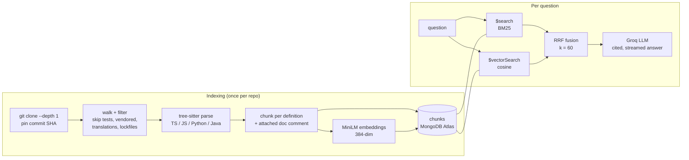

# Spelunk

Ask a codebase how it works. Spelunk clones a GitHub repository, parses it into
functions, classes and doc sections, indexes every chunk for **keyword (BM25)**
and **semantic (vector)** search in MongoDB Atlas, fuses the two rankings with
**Reciprocal Rank Fusion**, and has an LLM answer questions with citations to
exact lines.

The demo target is [**morluto/rea**](https://github.com/morluto/rea) (*REA: Reverse
Engineer Anything*), an MCP server for reverse-engineering binaries, apps and
runtime behaviour. It's a deliberately hard target: ~2,700 indexable files, ~620k
lines, mostly TypeScript, plus a Java Ghidra bridge and a Python Hopper bridge.
So this is a tool for reverse-engineering the reverse-engineering tool.

**Stack:** FastAPI · MongoDB Atlas Search + Atlas Vector Search · Groq LLM (`gpt-oss-120b`)
· fastembed (all-MiniLM-L6-v2, ONNX) · tree-sitter · React + Vite.
It shares its stack with [Margin](https://github.com/Bhumikams/margin), the study-notes RAG app.

---

## What it does

| View | What you get |
|---|---|
| **Ask** | A streamed answer. Every claim cites a source `[n]`; click it to open the exact lines. Each source card shows its **keyword rank and semantic rank**, so you can see *why* hybrid picked it. Switch between hybrid, keyword and semantic per question. |
| **Compare search** | One query, three columns: keyword, semantic, hybrid. The quickest way to see what each retriever is good and bad at. |
| **Architecture map** | An LLM-written map of the repo (entry points, request flow, main modules, where to start reading), built from the README, `AGENTS.md`, `docs/architecture.mermaid`, directory stats and the largest classes. |
| **Files** | Every indexed file. The code viewer jumps between the definitions in a file and links to GitHub at the pinned commit. |

## How it works



### 1. Code-aware chunking (`backend/app/chunker.py`)

Splitting code every N characters cuts functions in half and loses the name of
what you're looking at. Spelunk parses each file with **tree-sitter** and makes
one chunk per definition (function, method, class, interface, type, enum), with
the JSDoc/comment above it attached.

- **Big classes** (REA has several 2,000+ line classes) become one *outline* chunk
  (signature plus member list) and one chunk per method, named `Class.method`.
- **Long functions** are split into overlapping windows that repeat the signature,
  so part 3 of `ghidraHeadlessArguments` still says what it belongs to.
- **Tiny types and constants** next to each other are grouped. Functions always keep
  their own chunk and name.
- **Markdown** is split by heading, with a breadcrumb like `IDA provider > Give REA a target`.
- Everything else falls back to line windows. Coverage on REA is 100% of non-blank lines.

A regex chunker would break on TypeScript template literals (`` `${"{"}` ``),
decorators and braces inside strings. A real parser doesn't.

### 2. Two retrievers

| | Keyword (Atlas Search, BM25) | Semantic (Atlas Vector Search) |
|---|---|---|
| Sees | code, file path, doc comment, symbol names (boosted 3×), and every identifier split into words | path, kind, symbol name in words, doc comment, then code; MiniLM reads ~256 tokens |
| Good at | `parseMcpHttpEndpoint`, error strings, file names | "how does the server shut down on SIGTERM?" |
| Bad at | paraphrases, questions with no shared words | exact identifiers, rare names |

Identifier splitting is the small trick that matters most for code: `GhidraLaunchFailure`
is indexed as `ghidra launch failure` too, so plain words find camelCase names.

### 3. Reciprocal Rank Fusion (`backend/app/hybrid.py`)

BM25 scores (unbounded) and cosine scores (0–1) aren't on the same scale, so
adding them is meaningless. RRF uses only each result's **rank** in each list:

```
score(chunk) = Σ over retrievers  1 / (60 + rank)
```

A chunk that is #3 in keyword and #5 in semantic beats one that is #1 in only
one list. Both searches run in parallel; RRF is ~15 lines of Python, written by
hand rather than using Atlas's `$rankFusion` so it can be explained, tested and
tuned (an optional identifier-weighted variant is measured by the eval).

### 4. Grounded answers

The top 6 chunks go to the LLM as numbered sources (`[n] path:start-end (kind symbol)`
plus code). The prompt requires a citation on every claim, call order for "how does X
work" questions, and a plain "the sources don't show this" instead of guessing.
Answers stream over server-sent events, and every citation links to GitHub at the
indexed commit SHA, so links don't drift when REA moves on.

### Storage in Atlas (free M0 tier)

| Collection | Holds |
|---|---|
| `repos` | URL, pinned commit, indexing status/progress, stats, cached architecture map |
| `chunks` | one document per chunk + 384-dim embedding (stored as **packed float32 BSON**, ~1.5 KB instead of ~3.5 KB as doubles) |
| `files` | full file text for the code viewer |

Two search indexes on `chunks`, both created by `scripts/create_indexes.py`:
`vector_index` (cosine, filtered by `repo_id`) and `text_index` (Lucene BM25).
M0 allows three.

---

## Evaluation

`backend/eval/rea_questions.json` has **30 questions about REA with hand-checked
answers**: 15 phrased as identifiers (`SessionProviderRouter`) and 15 as plain
English ("How does REA find a Ghidra installation and check which Java version it
needs?"). A hit means the right file appears in the top 5.

```
eval.bat                       # or: python -m scripts.eval --k 5 --boost 1.5 --verbose
```

Measured on REA @ `93b8b82` (Atlas Search + Atlas Vector Search, all-MiniLM-L6-v2, k = 5):

| Retriever | Identifier queries (15) | Natural-language queries (15) | All 30 |
|---|---|---|---|
| Keyword (BM25) | 1.00 hit@5 · MRR 0.95 | 0.53 hit@5 · MRR 0.26 | 0.77 hit@5 · MRR 0.61 |
| Semantic (MiniLM) | 0.93 hit@5 · MRR 0.78 | 0.60 hit@5 · MRR 0.44 | 0.77 hit@5 · MRR 0.61 |
| **Hybrid (RRF)** | **1.00 hit@5 · MRR 1.00** | **0.80 hit@5 · MRR 0.54** | **0.90 hit@5 · MRR 0.77** |

Each retriever alone finds the right file for 23 of 30 questions; fused, they find
27. Keyword search never misses an identifier but finds only half of the plain-English
questions; semantic search is better on English but drops exact names like
`parseMcpHttpEndpoint`. Fusion also rescues two questions that *neither* retriever had
in its own top 5 (the ASAR header limit and the rules for adding an MCP tool): the
right file sat lower in the individual lists, and fusing the rankings lifted it into the
top 5. Weighting keyword search 1.5× for code-looking queries changed nothing
(identifier queries were already 1.00), so it stays off by default.

Still missed by all three: "How does REA decide which analysis provider handles a
binary?", "Where are MCP tools registered on the server?" and "How does rea setup
register itself with agents…". Those answers are spread over many small files, which
is where a call graph or query rewriting would help next.

---

## Run it (Windows)

1. Get a free **Groq key**: <https://console.groq.com/keys>
2. Create a free **MongoDB Atlas M0** cluster. Under *Database Access* add a user;
   under *Network Access* allow your IP (or `0.0.0.0/0` for the hosted demo); then
   *Connect > Drivers* and copy the connection string.
3. Double-click **`start.bat`**. It asks for both, installs everything, creates the
   two Atlas search indexes and opens <http://localhost:5173>.
4. Double-click **`index-rea.bat`** to index REA (clone, parse, embed ~25k chunks;
   a few minutes on a laptop CPU, with progress shown), then refresh the page.

Pressing Enter instead of a connection string runs everything in memory with no
database, which is fine for a quick look but means re-indexing on every restart.

<details>
<summary>macOS / Linux, or doing it by hand</summary>

```bash
cd backend
python -m venv .venv && source .venv/bin/activate
pip install -r requirements.txt
cp .env.example .env            # add GROQ_API_KEY and MONGODB_URI
python -m scripts.create_indexes
python -m scripts.index_repo    # morluto/rea by default
uvicorn app.main:app --reload --port 8000

cd ../frontend && npm install && npm run dev   # http://localhost:5173
```

Index another repo: `python -m scripts.index_repo https://github.com/pallets/flask`,
or paste the URL into the app.
</details>

Tests run offline (in-memory store, hash embedder, fake LLM):

```bash
cd backend && pytest -q        # 18 tests: chunker, globs, RRF, BM25, API, SSE streaming
```

## Deploy (Render, free)

Index REA from your machine into Atlas first. The hosted app is **read-only**: it
serves the existing index and won't let visitors start indexing jobs.

1. Push to GitHub.
2. Render: *New > Blueprint*, pick the repo. `render.yaml` builds the Dockerfile.
3. Paste `GROQ_API_KEY` and `MONGODB_URI` when asked.

The image bakes in the embedding model, so the first query doesn't wait on a download.

## Project layout

```
backend/
  app/
    repo.py        clone, include/exclude rules, per-repo presets (REA's lives here)
    chunker.py     tree-sitter chunking, identifier splitting
    indexer.py     clone → walk → chunk → embed → store, with progress
    store.py       AtlasStore ($search, $vectorSearch) and MemoryStore (BM25 + numpy)
    hybrid.py      parallel retrieval, RRF, overlap de-duplication
    rag.py         prompts, citations, architecture map
    llm.py         Groq / Claude, streaming
    main.py        FastAPI routes (SSE for /ask)
  scripts/         create_indexes, index_repo, eval
  eval/            rea_questions.json
  tests/
frontend/src/
  components/      AskView, CompareView, MapView, FilesView, CodePanel, SourceCard …
```

## Limits worth knowing

- Chunks are definitions, not call graphs. "Who calls X?" works through keyword
  search for the name, but there's no static call-graph analysis.
- MiniLM is a small general-purpose model; a code-specific embedding model would
  likely help the semantic half (`EMBED_MODEL` / `EMBED_DIM`, then recreate the index).
- Groq's free tier limits tokens per minute, so prompts are capped (~6 sources × 1,800
  chars). Bursts of questions can still hit a rate limit.
- Only Python, TypeScript/JavaScript and Java get definition-level chunking; other
  languages fall back to line windows.
